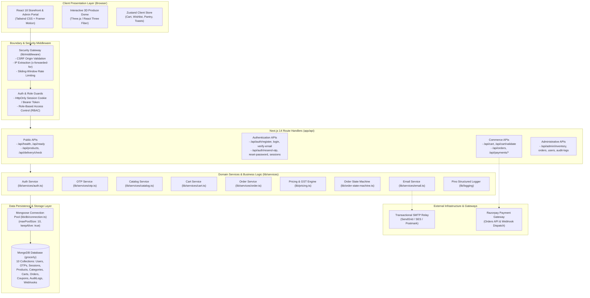

# Grocerly — System Architecture & Component Specification

**Document Identifier:** `DOC-ARCH`  
**Current Version:** 2.0.0  
**Status:** Verified & Active  
**Last Reviewed:** October 18, 2026  

---

## 1. Architectural Overview

Grocerly is architected as a modular, full-stack monolith leveraging Next.js 14 App Router, React 18 Server and Client Components, TypeScript, and MongoDB with Mongoose ODM. The application delivers low-latency server rendering, responsive client interactivity, strict cryptographic authentication, and transactional e-commerce workflows.



---

## 2. Component Boundaries & Responsibility Separation

### 2.1 Presentation & Storefront (`app/` & `components/`)

- **Server Components**: Handle static page scaffolding, SEO metadata generation, and initial server rendering.
- **Client Components (`'use client'`)**:
  - `components/home/SmartMealPlanner.tsx`: Interactive recipe ingredient scaling, pantry deduplication, shortfall detection, and automated cart population.
  - `components/3d/FreshnessOrbit.tsx`: WebGL 3D produce dome rendered via Three.js with graceful static fallback (`components/3d/OrbitFallback.tsx`).
  - `components/layout/CartDrawer.tsx` & `FloatingCartBar.tsx`: Responsive slide-over drawer managing quantity adjustments, coupon redemption, and real-time total updates.
  - `app/admin/**`: Internal back-office consoles for inventory management, order transitions, user verification auditing, and security audit log analysis.

### 2.2 Security Middleware & Interceptors (`lib/middleware/`)

- **`applySecurityChecks(req, prefix, limit, windowMs)`**:
  1. **CSRF Mitigation**: Validates that incoming `Origin` matches the server `Host` header on mutating HTTP methods (`POST`, `PUT`, `PATCH`, `DELETE`).
  2. **Rate Limiting**: Extracts client IP address behind reverse proxies (`x-forwarded-for`, `x-real-ip`) and evaluates against sliding-window buckets in `lib/security.ts`. Returns HTTP 429 with `Retry-After` header when exceeded.
  3. **Request Tracing**: Injects or generates unique `x-request-id` attached to all audit records and error responses.
- **`getSessionUser(req)`**: Extracts session identifier from HttpOnly cookie `grocerly_session` or `Authorization: Bearer <token>` and verifies HMAC-SHA256 digest against active MongoDB sessions.
- **`requireAuth(req)`**: Enforces active authenticated session; throws `AuthenticationError` (HTTP 401) on missing or expired sessions.
- **`requireRole(req, allowedRoles)`**: Enforces Role-Based Access Control (`CUSTOMER`, `OPS`, `ADMIN`); throws `AuthorizationError` (HTTP 403) on unauthorized privilege escalations.

### 2.3 Core Domain Services (`lib/services/`)

- **Authentication Service (`lib/services/auth.ts`)**:
  - Manages customer registration, login verification, session generation, password changes, and password reset flows.
  - Enforces Bcrypt (salt rounds 12) with legacy Scrypt timing-safe verification.
  - Emits audit events (`USER_REGISTERED`, `AUTH_LOGIN_SUCCESS`, `AUTH_LOGIN_FAILED`, `PASSWORD_RESET_COMPLETED`).
- **OTP Challenge Service (`lib/services/otp.ts`)**:
  - Generates cryptographically secure 6-digit numeric codes via `crypto.randomInt(100000, 1000000)`.
  - Hashes OTP codes using HMAC-SHA256 with `AUTH_SECRET`; stores zero plaintext OTPs in the database.
  - Manages atomic consumption, 300-second TTL expiration, 5-attempt lockout, and 60-second resend cooldowns.
- **Pricing & Tax Engine (`lib/pricing.ts`)**:
  - Calculates subtotal, item discounts, promotional coupon reductions, statutory 5% GST (2.5% CGST + 2.5% SGST), and delivery fees.
  - Computes all intermediate values in integer paise (`Math.round(rupees * 100)`) to eliminate floating-point drift.
- **Order Fulfillment Service (`lib/services/order.ts`)**:
  - Orchestrates multi-step checkout: idempotency deduplication, live stock verification, atomic inventory decrements, pricing snapshotting, and order creation.
  - Enforces finite state machine validation via `lib/order-state-machine.ts`.
  - Restores stock automatically upon order cancellation.
- **Transactional Email Service (`lib/services/email.ts`)**:
  - Delivers HTML and plaintext notification templates for verification OTPs, password reset links, order confirmations, and status updates.
  - Isolates automated test execution via in-memory queue (`sentEmailsTestQueue`). Outside tests, unconfigured SMTP triggers clean, explicit errors without fabricating success.

### 2.4 Data Persistence & MongoDB Schemas (`lib/models/`)

- Utilizes Mongoose 8 with a cached connection manager (`lib/db/connection.ts`) tailored for Node.js servers and serverless request reuse.
- Ten authoritative collections:
  - `users`: Customer & staff credentials, verification state, delivery addresses.
  - `otpchallenges`: Cryptographic OTP digests, expiration timestamps, attempt counters.
  - `sessions`: Active login sessions, device user-agents, IP records, TTL expiration.
  - `products`: Product catalog, SKU, stock count, reserved stock, full-text search indexes.
  - `categories`: Storefront grocery categories, icons, and item counts.
  - `carts`: User and guest persistent cart contents with applied coupons.
  - `orders`: Authoritative purchase orders, pricing snapshots, address, timeline audit history.
  - `auditlogs`: Append-only security audit trail with actor IDs and outcome classifications.
  - `coupons`: Active discount codes, limits, minimum spends, and expiration rules.
  - `processedwebhooks`: Idempotency registry for external payment webhooks (30-day TTL).

---

## 3. Technology Stack & Pinned Versions

| Layer | Component / Library | Pinned Version | Rationale & Responsibility |
| :--- | :--- | :--- | :--- |
| **Framework** | `next` | `14.2.15` | Pinned Next.js 14 LTS release declared in package.json. App Router architecture with Route Handlers. |
| **Runtime** | `node` | `>=20.17.0` | Node.js LTS engine providing native crypto, fetch, and native test runner (`node --test`). |
| **UI Library** | `react` / `react-dom` | `18.3.1` | Concurrent React runtime supporting Server Components and Client Components. |
| **Language** | `typescript` | `5.6.3` | Strict static type safety (`tsc --noEmit` verified with 0 errors). |
| **Styling** | `tailwindcss` | `3.4.14` | Utility-first responsive design system with custom brand color palette. |
| **3D Rendering** | `three` / `@react-three/fiber` | `^0.169.0` / `^8.17.10` | WebGL hardware-accelerated produce dome visualization. |
| **State** | `zustand` | `5.0.0` | Lightweight client-side reactive store with local storage persistence. |
| **Database** | `mongoose` | `8.7.0` | Authoritative ODM with schema validation, compound indexes, and connection pooling. |
| **Validation** | `zod` | `4.6.7` | Runtime type assertion and request payload validation. |
| **Security** | `bcryptjs` | `3.0.3` | Cost factor 12 password hashing with timing-safe comparison. |
| **Email** | `nodemailer` | `10.1.2` | Production SMTP client with multi-part HTML/plaintext email delivery. |
| **Logging** | `pino` | `10.4.0` | High-throughput structured JSON logger with central credential redaction. |

---

## 4. Cross-Cutting Architectural Patterns

### 4.1 Strict Money Representation (Integer Paise)
Floating-point arithmetic in JavaScript can introduce rounding errors (e.g. `0.1 + 0.2 === 0.30000000000000004`). Grocerly calculates all subtotal lines, tax amounts, discounts, and final totals in integer paise:
$$\text{paise} = \text{Math.round}(\text{rupees} \times 100)$$
$$\text{rupees} = \frac{\text{Math.round}(\text{paise})}{100}$$
Razorpay and internal checkout engines strictly communicate in integer paise.

### 4.2 Idempotency & Concurrency Safety
1. **Order Creation**: The client generates or passes an `idempotencyKey`. The database enforces a sparse unique index on `orders.idempotencyKey`. Concurrent submissions return the existing order rather than charging twice.
2. **Stock Decrement**: Stock reservations use atomic MongoDB updates with query conditions:
   ```typescript
   await ProductModel.findOneAndUpdate(
     { id: product.id, stock: { $gte: quantity } },
     { $inc: { stock: -quantity, soldCount: quantity } }
   );
   ```
   If stock is insufficient or reserved concurrently, the transaction aborts and informs the user.

### 4.3 Zero Credential Leakage
Pino logging and API serialization layers filter sensitive attributes:
- Logger redacts: `password`, `passwordHash`, `secret`, `token`, `otp`, `otpHash`, `signature`, `cookie`, `cvv`.
- User serialization maps MongoDB documents through `toSafeUser()`, permanently omitting `passwordHash` and internal challenge data.
