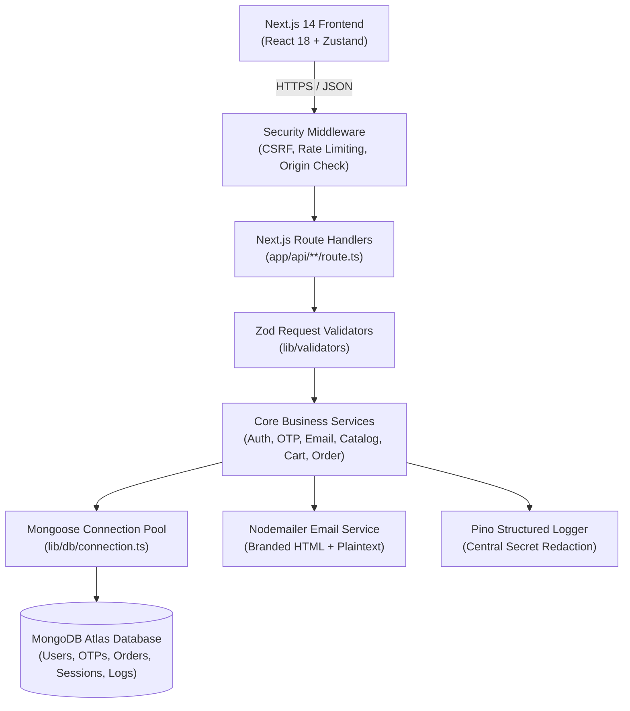

# Grocerly — Architecture & Security Specification

## 1. System Overview

Grocerly is a full-stack, farm-to-table grocery e-commerce web application engineered with Next.js 14 App Router, React 18, TypeScript, Tailwind CSS, Mongoose ODM with MongoDB Atlas, and a cryptographically hardened authentication and verification pipeline.

## 2. Layered Architecture

- **Presentation Layer (`app/` and `components/`)**:
  - Next.js 14 App Router with client components for reactive interactions (Framer Motion animations, Canvas Confetti, Three.js 3D produce dome, Zustand global cart and user state).
  - Public routes: `/`, `/shop`, `/product/[id]`, `/recipes`, `/cart`, `/login`, `/register`, `/verify-email`, `/forgot-password`, `/reset-password`, `/privacy`, `/terms`, `/contact`.
  - Authenticated routes: `/dashboard`, `/profile`, `/settings/security`, `/wishlist`, `/checkout`, `/confirmation`, `/orders`, `/orders/[id]`.
  - Administrative console: `/admin`, `/admin/users`, `/admin/products`, `/admin/orders`, `/admin/audit-logs`.

- **Security & Middleware Layer (`lib/middleware/`)**:
  - `applySecurityChecks`: Origin verification on mutation requests (CSRF mitigation), client IP extraction behind reverse proxies (`x-forwarded-for`), sliding-window rate limiting.
  - `requireAuth`: Enforces valid session cookie or HMAC bearer token.
  - `requireRole`: Enforces role-based permissions (`ADMIN`, `OPS`, `CUSTOMER`).

- **Data Models (`lib/models/`)**:
  - `User`: Normalized email unique index, hashed password, verification status, delivery addresses.
  - `OtpChallenge`: SHA-256/HMAC hashed OTP, purpose, TTL expiry index, failed attempt counter, atomic consumption.
  - `Session`: Hashed session token, expiration TTL index, user reference, revocation timestamp.
  - `Product`: SKU unique index, category index, full-text search index, live stock & reserved stock.
  - `Order`: Unique alphanumeric ID, sparse unique `idempotencyKey` index, purchase-time product snapshots, delivery address, timeline status history.
  - `AuditLog`: Structured audit trail with actor correlation, resource references, and timestamp index.

- **Pricing Engine (`lib/pricing.ts`)**:
  - Integer paise precision eliminates floating-point drift across currency calculations.
  - 5% statutory GST calculated inclusively and divided equally into CGST (2.5%) and SGST (2.5%).
  - Free delivery rule (threshold ≥ ₹300, else ₹40 standard delivery fee).
  - Coupon rules (`FRESH50`, `ORGANIC10`, `WELCOME100`) validated server-side.

- **Order State Machine (`lib/order-state-machine.ts`)**:
  - `PENDING_PAYMENT` → `CONFIRMED` → `PROCESSING` → `PACKED` → `OUT_FOR_DELIVERY` → `DELIVERED`.
  - Role-based transition guard: Customers can only cancel unfulfilled orders (`PENDING_PAYMENT` or `CONFIRMED`). Operations/Admin can advance fulfillment. Terminal states (`DELIVERED`, `CANCELLED`, `REFUNDED`) prevent illegal rollbacks.

## 3. Security Model

1. **Authentication**: Passwords hashed with bcrypt (salt rounds 12) or scrypt with 16-byte random salt.
2. **Verification Gate**: Unverified customers cannot log in or check out; automated OTP challenge is issued.
3. **Session Cookies**: `HttpOnly`, `SameSite=Lax`, `Secure` in production environments, scoped path `/`.
4. **Log Redaction**: Centrally strips `password`, `token`, `otp`, `secret`, `signature`, `cookie`, `cvv` from all log events.
5. **NoSQL Injection Defenses**: Input validation and sanitization strip MongoDB operator keys (`$gt`, `$where`, `__proto__`).
