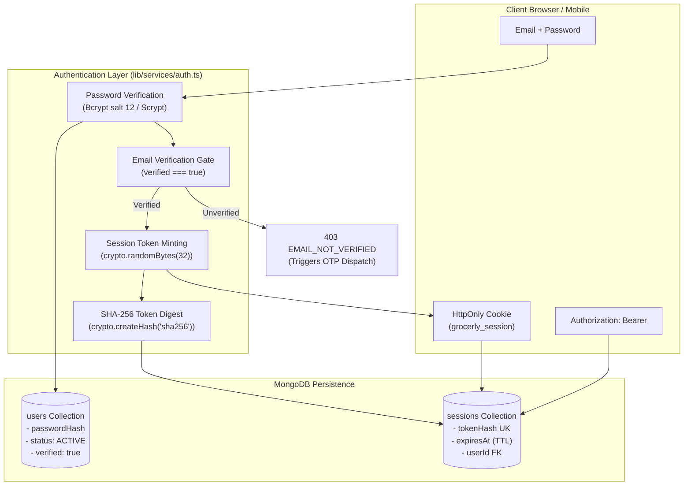

# Grocerly — Authentication, Authorization & Identity Lifecycle

**Document Identifier:** `DOC-AUTH`  
**Current Version:** 2.0.0  
**Status:** Verified & Active  
**Last Reviewed:** October 18, 2026  

---

## 1. Authentication Architecture

Grocerly implements a defense-in-depth identity model designed to protect customer privacy, eliminate user enumeration, prevent session hijacking, and safeguard administrative resources.



---

## 2. Password Storage & Verification

1. **Bcrypt (Primary Standard)**:
   - All newly registered users and password updates are hashed using `bcryptjs` with **12 salt rounds**.
   - Work factor protects against offline dictionary attacks and GPU cracking.
2. **Scrypt (Legacy Fallback)**:
   - Existing accounts created with Scrypt (`scrypt:<salt>:<derivedKey>`) are verified using constant-time comparison (`crypto.timingSafeEqual`).
3. **Password Complexity Requirements (`lib/validators/index.ts`)**:
   - Minimum 8 characters.
   - At least 1 uppercase letter (`[A-Z]`).
   - At least 1 lowercase letter (`[a-z]`).
   - At least 1 digit (`[0-9]`).
   - At least 1 special character (`[!@#$%^&*(),.?":{}|<>]`).

---

## 3. Cryptographic Email OTP Challenge Lifecycle

The OTP pipeline verifies user email ownership without storing plaintext verification codes in the database.

| Stage | Mechanism / Rule | Implementation Detail |
| :--- | :--- | :--- |
| **Generation** | `crypto.randomInt(100000, 1000000)` | Generates uniform 6-digit numeric string (`"100000"` to `"999999"`). |
| **Digest Storage** | HMAC-SHA256 with `AUTH_SECRET` | Database stores only `otpHash = createHmac("sha256", AUTH_SECRET).update("otp:" + code).digest("hex")`. |
| **Plaintext Egress**| Transactional Email only | Plaintext code is sent exclusively via Nodemailer; never logged, never returned in API responses. |
| **Time-to-Live (TTL)** | 300 seconds (5 minutes) | Verified against challenge creation timestamp; MongoDB TTL index purges challenge after 24 hours. |
| **Attempt Throttling** | Maximum 5 attempts | Each incorrect submission increments `failedAttempts`. Upon 5th failure, challenge is permanently locked. |
| **Resend Cooldown** | 60 seconds | `resendCooldownUntil = now + 60s`. Requests within cooldown return HTTP 429. |
| **Atomic Consumption** | Single-use invalidation | Successful verification sets `consumedAt = new Date()` atomically; subsequent submissions fail immediately. |

---

## 4. Session Architecture & Cookie Security

### 4.1 Session Minting & Storage
Upon successful authentication, the server:
1. Generates a 32-byte cryptographic random token:
   $$\text{rawToken} = \text{crypto.randomBytes}(32).\text{toString}(\text{"hex"})$$
2. Computes SHA-256 digest:
   $$\text{tokenHash} = \text{crypto.createHash}(\text{"sha256"}).\text{update}(\text{rawToken}).\text{digest}(\text{"hex"})$$
3. Persists record in MongoDB `sessions` collection with `userId`, `role`, `ipAddress`, `userAgent`, and `expiresAt` (7 days from creation).
4. Transmits `rawToken` to the client.

### 4.2 Browser Cookie Configuration
The session cookie is configured with strict security flags:
```http
Set-Cookie: grocerly_session=<rawToken>; Path=/; HttpOnly; SameSite=Lax; Max-Age=604800; Secure
```
- `HttpOnly`: Blocks client-side JavaScript access (`document.cookie`), mitigating XSS session theft.
- `SameSite=Lax`: Prevents cross-site cookie transmission on third-party requests while preserving cookies on top-level navigation.
- `Secure`: Enforced in production (`NODE_ENV === "production"`), transmitting cookies only over HTTPS/TLS.
- `Path=/`: Restricts scope to application domain root.

### 4.3 Session Revocation
- **Explicit Logout (`POST /api/auth/logout`)**: Deletes session record from MongoDB and sets cookie `Max-Age=0`.
- **Password Reset / Change**: Immediately deletes all active session documents matching `userId`, terminating all logged-in devices.
- **Remote Revocation (`DELETE /api/auth/sessions/[id]`)**: Allows users to terminate specific device sessions from `/settings/security`.

---

## 5. Role-Based Access Control (RBAC)

The system enforces three distinct authorization tiers across all route handlers and administrative pages:

```
┌────────────────────────────────────────────────────────┐
│                        ADMIN                           │
│  - User Directory Audit (/admin/users)                 │
│  - Security Audit Logs (/admin/audit-logs)             │
│  - Product Price Modifications                         │
│  - Promotional Coupon Management                       │
│  - Issue Order Refunds                                 │
├────────────────────────────────────────────────────────┤
│                         OPS                            │
│  - Inventory Stock Adjustments (/admin/inventory)      │
│  - Order Fulfillment Console (/admin/orders)           │
│  - Advance Operational Order States                    │
├────────────────────────────────────────────────────────┤
│                       CUSTOMER                         │
│  - Personal Cart Management (/cart)                    │
│  - Checkout & Order Placement (/checkout)              │
│  - View Own Order History (/orders, /orders/[id])      │
│  - Cancel Own Unfulfilled Orders (CONFIRMED state)     │
│  - Manage Personal Delivery Addresses (/profile)       │
└────────────────────────────────────────────────────────┘
```

### 5.1 Enforcement Mechanics (`lib/middleware/index.ts`)
- **`requireAuth(req)`**: Verifies session. Throws HTTP 401 if unauthenticated.
- **`requireRole(req, allowedRoles)`**: Verifies that `user.role` matches one of `allowedRoles`. Throws HTTP 403 `FORBIDDEN` if unauthorized.
- **Resource Ownership Guard**: Non-admin routes enforce `session.userId === resource.userId`. Non-admin attempts to view other customer orders return HTTP 403 `Forbidden: You do not have permission to view another customer's order.`
