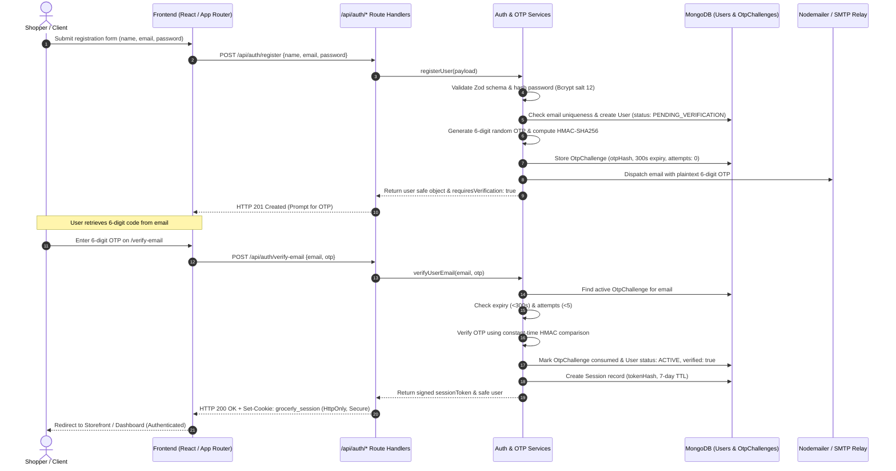
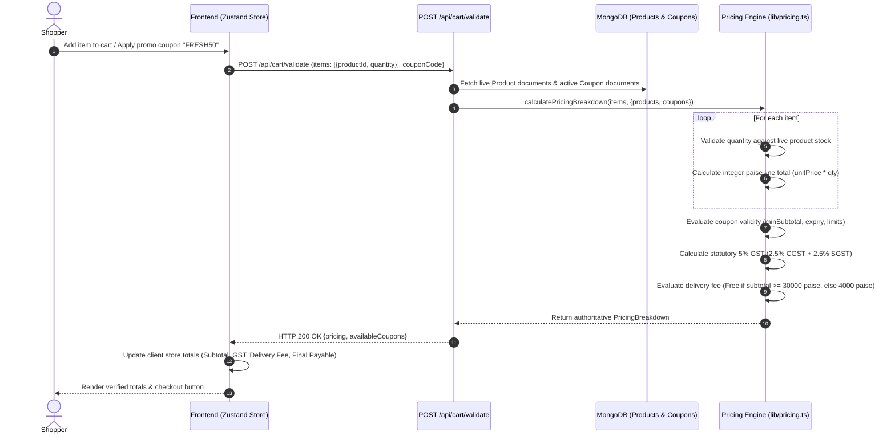
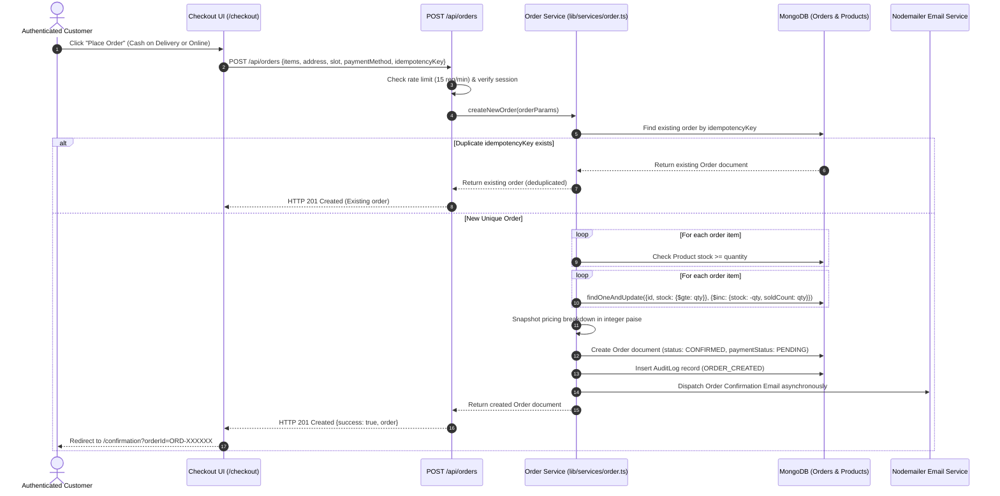
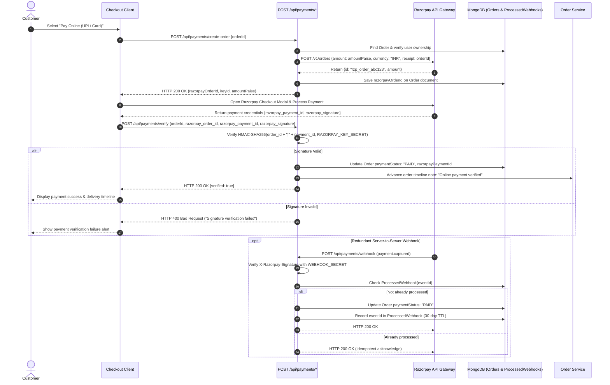
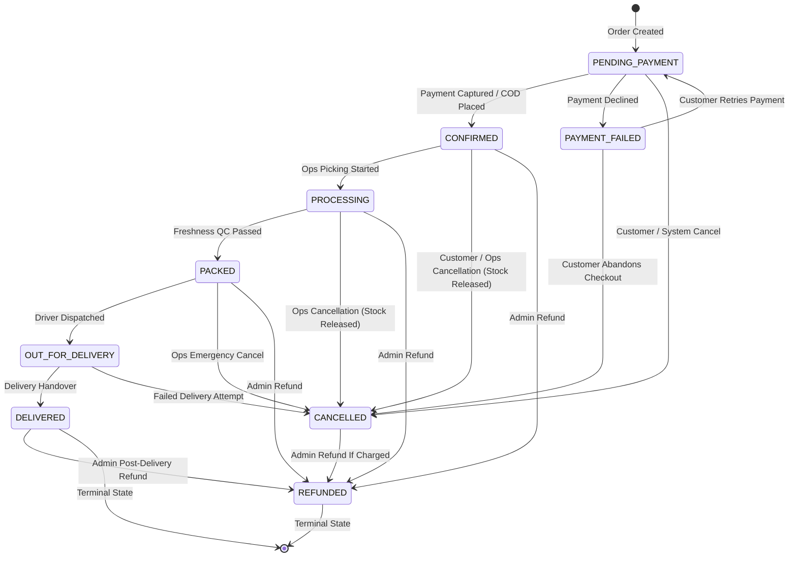

# Grocerly — Data Flows & Sequence Diagrams

**Document Identifier:** `DOC-FLOW`  
**Current Version:** 2.0.0  
**Status:** Verified & Active  
**Last Reviewed:** October 18, 2026  

---

## 1. Authentication & Email OTP Verification Lifecycle

This sequence illustrates the end-to-end registration, cryptographic OTP delivery, verification, and session establishment workflow.

---

## 2. Cart Synchronization & Server-Side Pricing Validation

This sequence details how client carts are reconciled with live database stock and authoritative server-side pricing.

---

## 3. Order Placement & Atomic Inventory Reservation

This sequence illustrates the checkout workflow, including idempotency deduplication and atomic stock decrementing.

---

## 4. Online Payment Verification & Webhook Handling (Razorpay)

This sequence details online payment initialization, HMAC signature verification, and redundant webhook processing.

---

## 5. Order State Machine & Fulfillment Workflow

This diagram models the permissible operational state transitions and actor authority.

