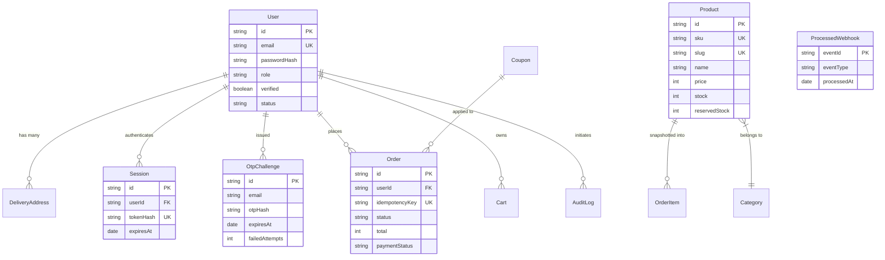

# Grocerly — Database Architecture, Schema & Index Reference

**Document Identifier:** `DOC-DB`  
**Current Version:** 2.0.0  
**Status:** Verified & Active  
**Last Reviewed:** October 18, 2026  

---

## 1. Database Architecture & Connection Strategy

Grocerly utilizes MongoDB (6.0+ / Atlas) as its authoritative document datastore, accessed via Mongoose ODM (`v8.7.0`).

### 1.1 Connection Pooling (`lib/db/connection.ts`)
In serverless and standard Node.js runtime environments, Mongoose connection pooling is cached on the Node global object (`global.mongooseGlobal`):
- `maxPoolSize`: 10 persistent socket connections
- `serverSelectionTimeoutMS`: 5,000ms
- `socketTimeoutMS`: 45,000ms
- `bufferCommands`: false (fails immediately with 503 rather than queuing requests during database disconnection)

### 1.2 Entity-Relationship Diagram

---

## 2. Collection Schemas & Field Definitions

### 2.1 `users` Collection (`UserModel` in `lib/models/User.ts`)
Stores customer accounts, staff profiles, role privileges, and delivery address books.

| Field Name | Type | Constraints & Defaults | Description |
| :--- | :--- | :--- | :--- |
| `id` | `String` | Required, Unique, Indexed | Application-level identifier (`usr_<timestamp>_<hex>`). |
| `name` | `String` | Required, Trimmed | Full display name. |
| `email` | `String` | Required, Unique, Lowercase, Trimmed | Primary email address. |
| `passwordHash` | `String` | Required | Bcrypt (salt rounds 12) or Scrypt hash. |
| `phone` | `String` | Optional, Trimmed | Contact mobile number. |
| `role` | `String` | Enum: `["CUSTOMER", "ADMIN", "OPS"]`, Default: `"CUSTOMER"` | RBAC authorization level. |
| `verified` | `Boolean`| Default: `false` | True once email OTP challenge is consumed. |
| `emailVerifiedAt`| `Date` | Optional | Timestamp when email was successfully verified. |
| `status` | `String` | Enum: `["ACTIVE", "SUSPENDED", "PENDING_VERIFICATION"]`, Default: `"PENDING_VERIFICATION"` | Account lifecycle status. |
| `addresses` | `Array` | Subdocument `DeliveryAddressSchema`, Default: `[]` | Saved delivery addresses. |
| `failedLoginAttempts` | `Number` | Default: `0` | Consecutive failed login counter. |
| `lockUntil` | `Date` | Optional | Lockout timestamp if failed attempts exceed limit. |
| `createdAt` / `updatedAt` | `Date` | Timestamps: `true` | Automated Mongoose audit dates. |

**Indexes**:
- `unique`: `{ id: 1 }`
- `unique`: `{ email: 1 }`
- `index`: `{ role: 1 }`
- `index`: `{ status: 1 }`
- `compound`: `{ email: 1, status: 1 }`

---

### 2.2 `otpchallenges` Collection (`OtpChallengeModel` in `lib/models/OtpChallenge.ts`)
Manages cryptographic OTP verification challenges.

| Field Name | Type | Constraints & Defaults | Description |
| :--- | :--- | :--- | :--- |
| `id` | `String` | Required, Unique, Indexed | Challenge ID (`otp_<timestamp>_<hex>`). |
| `userId` | `String` | Optional, Indexed | Associated user ID if registered. |
| `email` | `String` | Required, Lowercase, Indexed | Recipient email address. |
| `purpose` | `String` | Enum: `["EMAIL_VERIFICATION", "PASSWORD_RESET", "SENSITIVE_CHANGE"]`, Default: `"EMAIL_VERIFICATION"` | Security intent. |
| `otpHash` | `String` | Required | HMAC-SHA256 digest of `otp:<6-digits>` with `AUTH_SECRET`. Plaintext never saved. |
| `expiresAt` | `Date` | Required | Expiration timestamp (300 seconds from issue). |
| `failedAttempts`| `Number` | Default: `0` | Failed attempts counter (max 5). |
| `maxAttempts` | `Number` | Default: `5` | Maximum allowed attempts before challenge invalidation. |
| `consumedAt` | `Date` | Optional | Set atomically upon successful verification. |
| `resendCooldownUntil` | `Date` | Optional | Cooldown timestamp (60 seconds from issue). |

**Indexes**:
- `unique`: `{ id: 1 }`
- `index`: `{ email: 1 }`
- `index`: `{ userId: 1 }`
- `index`: `{ purpose: 1 }`
- `compound`: `{ email: 1, purpose: 1, consumedAt: 1 }`
- `TTL index`: `{ expiresAt: 1 }` with `expireAfterSeconds: 86400` (removes old challenges 24 hours after expiry).

---

### 2.3 `sessions` Collection (`SessionModel` in `lib/models/Session.ts`)
Manages distributed server-side user sessions.

| Field Name | Type | Constraints & Defaults | Description |
| :--- | :--- | :--- | :--- |
| `id` | `String` | Required, Unique, Indexed | Session ID (`sess_<timestamp>_<hex>`). |
| `userId` | `String` | Required, Indexed | Reference to authenticated `User.id`. |
| `tokenHash` | `String` | Required, Unique, Indexed | SHA-256 digest of the cookie/bearer session token. |
| `role` | `String` | Required | Snapshot of user role at session issuance. |
| `ipAddress` | `String` | Optional | Client IP address at session creation. |
| `userAgent` | `String` | Optional | Client browser User-Agent header. |
| `expiresAt` | `Date` | Required | Expiration date (Default: 7 days from creation). |
| `revokedAt` | `Date` | Optional | Timestamp if explicitly logged out or invalidated. |

**Indexes**:
- `unique`: `{ id: 1 }`
- `unique`: `{ tokenHash: 1 }`
- `index`: `{ userId: 1 }`
- `compound`: `{ userId: 1, revokedAt: 1 }`
- `TTL index`: `{ expiresAt: 1 }` with `expireAfterSeconds: 0` (automatically purged by MongoDB at expiration).

---

### 2.4 `products` Collection (`ProductModel` in `lib/models/Product.ts`)
Contains grocery products, stock levels, and search metadata.

| Field Name | Type | Constraints & Defaults | Description |
| :--- | :--- | :--- | :--- |
| `id` | `String` | Required, Unique, Indexed | Product identifier (`prod-spinach-01`). |
| `sku` | `String` | Unique, Sparse, Indexed | Stock Keeping Unit (`GRY-VEG-SPIN-01`). |
| `slug` | `String` | Required, Unique, Indexed | SEO URL slug (`organic-baby-spinach`). |
| `name` | `String` | Required, Trimmed | Product name. |
| `brand` | `String` | Required, Trimmed | Brand / farm origin name. |
| `category` | `String` | Required, Indexed | Category name (e.g. `Vegetables`, `Fruits`). |
| `price` | `Number` | Required, Min: 0 | Selling price in INR. |
| `originalPrice`| `Number` | Optional, Min: 0 | Maximum Retail Price (MRP) in INR. |
| `discount` | `Number` | Default: `0` | Percentage discount. |
| `stock` | `Number` | Required, Min: 0 | Available inventory pack count. |
| `reservedStock`| `Number` | Default: `0`, Min: 0 | Stock allocated to pending orders. |
| `soldCount` | `Number` | Default: `0` | Historical sales count. |
| `lowStockThreshold` | `Number` | Default: `10` | Alert threshold for restocking. |
| `unit` | `String` | Required | Packaging unit (e.g. `250g pack`, `1 kg`). |
| `freshnessScore`| `Number` | Default: `95` | Freshness meter percentage (0–100). |
| `organic` | `Boolean`| Default: `false` | True for certified organic produce. |

**Indexes**:
- `unique`: `{ id: 1 }`
- `unique, sparse`: `{ sku: 1 }`
- `unique`: `{ slug: 1 }`
- `compound`: `{ category: 1, stock: -1 }`
- `text index`: `{ name: "text", brand: "text", description: "text" }`

---

### 2.5 `orders` Collection (`OrderModel` in `lib/models/Order.ts`)
Stores purchase orders, snapshot line items, tax breakdowns, and fulfillment history.

| Field Name | Type | Constraints & Defaults | Description |
| :--- | :--- | :--- | :--- |
| `id` | `String` | Required, Unique, Indexed | Order reference (`ORD-<6-digits>-<hex>`). |
| `userId` | `String` | Required, Indexed | Customer identifier. |
| `idempotencyKey` | `String` | Unique, Sparse, Indexed | Deduplication key preventing duplicate checkouts. |
| `items` | `Array` | Subdocument `OrderItemSchema`, Required | Purchase-time product snapshots (price, unit, gstRate). |
| `address` | `Object` | Required | Snapshot delivery address (street, city, state, pin). |
| `deliverySlot` | `String` | Required | Selected delivery window ID. |
| `paymentMethod`| `String` | Enum: `["UPI", "CARD", "COD", "NETBANKING"]` | Payment channel. |
| `paymentStatus`| `String` | Enum: `["PENDING", "PAID", "AUTHORIZED", "CAPTURED", "FAILED", "CANCELLED", "REFUNDED"]` | Gateway state. |
| `razorpayOrderId` | `String` | Sparse, Indexed | Razorpay gateway order reference. |
| `razorpayPaymentId`| `String` | Sparse, Indexed | Razorpay transaction reference. |
| `status` | `String` | Enum: `["PENDING_PAYMENT", "CONFIRMED", "PROCESSING", "PACKED", "OUT_FOR_DELIVERY", "DELIVERED", "CANCELLED", "PAYMENT_FAILED", "REFUNDED"]` | Fulfillment state machine position. |
| `pricing` | `Object` | Subdocument, Required | Exact financial breakdown in paise / rupees. |
| `timeline` | `Array` | Subdocument `TimelineEventSchema` | Append-only fulfillment timeline events. |

**Indexes**:
- `unique`: `{ id: 1 }`
- `unique, sparse`: `{ idempotencyKey: 1 }`
- `index`: `{ userId: 1 }`
- `index`: `{ status: 1 }`
- `sparse`: `{ razorpayOrderId: 1 }`
- `sparse`: `{ razorpayPaymentId: 1 }`
- `compound`: `{ userId: 1, createdAt: -1 }`
- `compound`: `{ status: 1, createdAt: -1 }`

---

### 2.6 `auditlogs` Collection (`AuditLogModel` in `lib/models/AuditLog.ts`)
Software-level append-only security and operational audit trail.

| Field Name | Type | Constraints & Defaults | Description |
| :--- | :--- | :--- | :--- |
| `id` | `String` | Required, Unique, Indexed | Audit event ID (`audit_<timestamp>_<random>`). |
| `eventType` | `String` | Required, Indexed | Event code (e.g. `AUTH_LOGIN_SUCCESS`, `ORDER_CREATED`). |
| `actorId` | `String` | Required, Indexed | User ID or `"ANONYMOUS"` or `"SYSTEM"`. |
| `targetType` | `String` | Optional, Indexed | Entity type (`User`, `Order`, `Product`, `Coupon`). |
| `targetId` | `String` | Optional, Indexed | Target entity ID. |
| `outcome` | `String` | Enum: `["SUCCESS", "FAILURE", "DENIED"]` | Execution outcome. |
| `requestId` | `String` | Optional | Correlated `x-request-id`. |
| `ip` | `String` | Optional | Client IP address. |
| `metadata` | `Mixed` | Default: `{}` | Sanitized event context (credentials redacted). |
| `timestamp` | `Date` | Default: `Date.now`, Indexed | Event timestamp. |

**Indexes**:
- `unique`: `{ id: 1 }`
- `index`: `{ eventType: 1 }`
- `index`: `{ actorId: 1 }`
- `index`: `{ timestamp: -1 }`
- `compound`: `{ eventType: 1, timestamp: -1 }`
- `compound`: `{ actorId: 1, timestamp: -1 }`

---

### 2.7 Other Collections: `categories`, `carts`, `coupons`, `processedwebhooks`
- **`categories`**: Stores storefront departments (`Vegetables`, `Fruits`, `Dairy`, `Bakery`, `Beverages`, `Snacks`). Unique index on `id`.
- **`carts`**: Persistent shopping carts for authenticated users (`userId`) and anonymous visitors (`guestSessionId`). Indexed on `{ userId: 1 }` and `{ guestSessionId: 1 }`.
- **`coupons`**: Promotional discount rules (`FRESH50`, `ORGANIC10`, `WELCOME100`). Unique index on `{ code: 1 }`.
- **`processedwebhooks`**: Deduplication registry for incoming payment provider webhooks. Unique index on `{ eventId: 1 }`, TTL index on `{ processedAt: 1 }` with 30-day retention.

---

## 3. Database Migration & Schema Evolution Guidelines

1. **Additive Schema Principle**: All Mongoose schema evolutions must be backward-compatible. Add new fields with sensible defaults (`default: false`, `default: 0`, `default: []`).
2. **Zero In-Place Destruction**: Never rename fields in existing collections in-place. If renaming is necessary, support both fields concurrently during an interim deprecation cycle.
3. **Idempotent Seeding**: Run `npm run seed` to ensure all initial categories, products, coupons, and staff accounts exist.
