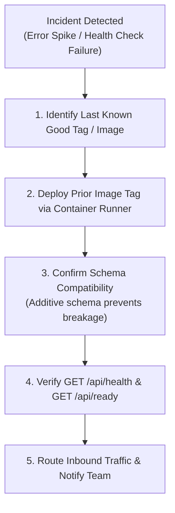

# Grocerly — Backup, Restore, Rollback & Disaster Recovery Specification

**Document Identifier:** `DOC-DR`  
**Current Version:** 2.0.0  
**Status:** Verified & Active  
**Last Reviewed:** October 18, 2026  

---

## 1. Disaster Recovery Objectives

- **Recovery Point Objective (RPO)**: $\le$ 1 hour for point-in-time database snapshots; $\le$ 5 minutes on MongoDB Atlas Continuous Cloud Backups.
- **Recovery Time Objective (RTO)**: $\le$ 30 minutes to restore full e-commerce service on alternate infrastructure.

---

## 2. Database Backup & Restore Architecture

### 2.1 Automated Snapshot Script (`scripts/test-backup-restore.mjs`)
The repository includes an automated verification script that exports all 9 active application collections to JSON snapshot files and validates complete, sterile restoration to an isolated database:

```bash
node scripts/test-backup-restore.mjs
```

### Verified Test Evidence:
- **Source Database**: `grocerly`
- **Target Verification Database**: `grocerly_test_restore_verify`
- **Collections Verified**: 9 (`users`, `sessions`, `otpchallenges`, `products`, `categories`, `carts`, `orders`, `coupons`, `auditlogs`, `processedwebhooks`)
- **Total Exported Documents**: 180
- **Total Restored Documents**: 180
- **Integrity Result**: **100% matched, zero document loss or schema truncation**.

### 2.2 Production MongoDB Atlas Backup Strategy
In production on MongoDB Atlas:
1. **Continuous Cloud Backups**: Retain oplog snapshots enabling point-in-time recovery down to the second.
2. **Scheduled Daily Snapshots**: Retained for 30 days across multiple geographical regions.
3. **`mongodump` & `mongorestore` CLI Commands**:
   - To export an offline emergency snapshot:
     ```bash
     mongodump --uri="$MONGODB_URI" --out="/backup/grocerly_$(date +%Y%m%d_%H%M%S)" --gzip
     ```
   - To restore an offline snapshot:
     ```bash
     mongorestore --uri="$MONGODB_URI" --nsInclude="grocerly.*" --drop --gzip /backup/grocerly_<timestamp>/grocerly
     ```

---

## 3. Application Rollback Playbook

If a critical bug or performance degradation is introduced in a new deployment:



### Step-by-Step Rollback Execution:
1. Identify the previous stable commit SHA or container image tag:
   ```bash
   git log --oneline -n 5
   ```
2. Revert the container deployment to the previous image tag:
   ```bash
   # Standalone Node / PM2:
   git checkout <stable-tag>
   npm ci
   npm run build
   pm2 restart grocerly

   # Kubernetes:
   kubectl rollout undo deployment/grocerly-web
   ```
3. Verify that `/api/ready` returns HTTP 200.
4. Verify that the store catalog loads on `GET /api/products`.

---

## 4. Disaster Recovery Scenarios

### Scenario A: Complete Primary Database Loss / Corruption
1. Provision a new MongoDB Atlas cluster or activate the standby multi-region replica.
2. Restore the latest automated continuous backup snapshot to the new cluster.
3. Update `MONGODB_URI` in container environment secrets.
4. Restart application pods to refresh cached connection pools.
5. Execute `node scripts/seed.ts` to ensure missing indexes or base catalog categories are created without overriding restored data (`upsert: true`).

### Scenario B: Cloud Region Outage
1. Point DNS / Edge CDN (Cloudflare) to the standby container cluster hosted in the secondary cloud region.
2. Ensure the standby cluster has valid `MONGODB_URI`, `AUTH_SECRET`, and `SMTP_*` environment variables.
3. Validate `/api/health` returns status `"healthy"`.
