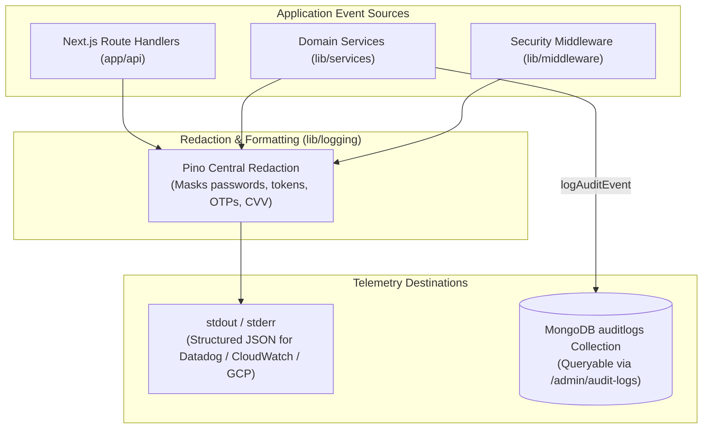

# Grocerly — Observability, Monitoring & Logging Specification

**Document Identifier:** `DOC-OBS`  
**Current Version:** 2.0.0  
**Status:** Verified & Active  
**Last Reviewed:** October 18, 2026  

---

## 1. Observability Architecture

Grocerly implements a unified observability stack comprising structured JSON logging, central credential redaction, health/readiness endpoints, and an append-only security audit trail.



---

## 2. Structured JSON Logging (Pino)

All server-side logs are formatted as structured JSON using Pino (`v10.4.0` in `lib/logging/index.ts`):

```json
{
  "level": 30,
  "time": "2026-10-18T14:56:34.532Z",
  "env": "production",
  "service": "grocerly-backend",
  "audit": {
    "id": "audit_1792335394532_x4yb4",
    "timestamp": "2026-10-18T14:56:34.532Z",
    "eventType": "USER_REGISTERED",
    "actorId": "usr_1792335394245_d1d89671",
    "targetType": "User",
    "targetId": "usr_1792335394245_d1d89671",
    "outcome": "SUCCESS",
    "metadata": {
      "email": "ananya@example.in"
    }
  },
  "msg": "AUDIT_EVENT: USER_REGISTERED [SUCCESS]"
}
```

### 2.1 Central Credential Redaction Policy
Pino and the application audit logger automatically sanitize sensitive parameters. Any key matching the following list (case-insensitive) is replaced with `"[REDACTED]"`:
- `password`
- `passwordHash`
- `resetTokenHash`
- `tokenHash`
- `token`
- `secret`
- `otp`
- `otpHash`
- `signature`
- `authorization`
- `cookie`
- `cardnumber`
- `cvv`

---

## 3. Health Checks & Diagnostic Probes

### 3.1 Liveness Probe (`GET /api/health`)
Evaluates process liveness, memory usage, database responsiveness, and email service availability:

```json
{
  "status": "healthy",
  "timestamp": "2026-10-18T15:00:00.000Z",
  "services": {
    "database": {
      "status": "connected",
      "pingMs": 3,
      "dbName": "grocerly"
    },
    "email": {
      "status": "ready"
    }
  },
  "system": {
    "uptimeSeconds": 3612.4,
    "heapUsedMB": 78.2
  }
}
```

- When SMTP is not configured, `services.email.status` returns `"unconfigured"`.
- When database connection fails, returns `status: "unhealthy"` with HTTP 503.

### 3.2 Readiness Probe (`GET /api/ready`)
Used by Kubernetes or Cloud Run to decide whether to direct inbound customer traffic to the pod:
- **HTTP `200 OK`**: Database is connected and accepting queries.
- **HTTP `503 Service Unavailable`**: Database disconnected or ping failed.

---

## 4. Security Audit Trail (`auditlogs` Collection)

The application maintains a software-level append-only audit trail in MongoDB for compliance and security forensics.

### Event Types Tracked:
- `USER_REGISTERED`: Customer account created.
- `USER_REGISTRATION_FAILED`: Duplicate email conflict.
- `EMAIL_VERIFIED`: Successful OTP consumption and account activation.
- `EMAIL_VERIFICATION_FAILED`: Expired, invalid, or exhausted OTP attempts.
- `AUTH_LOGIN_SUCCESS`: Authenticated session minted.
- `AUTH_LOGIN_FAILED`: Invalid credentials or locked account.
- `AUTH_LOGOUT`: Session revoked.
- `PASSWORD_RESET_REQUESTED`: Single-use recovery link issued.
- `PASSWORD_RESET_COMPLETED`: Password updated and existing sessions terminated.
- `ORDER_CREATED`: New purchase order placed.
- `ORDER_STATUS_UPDATED`: Order progressed or cancelled.
- `PRODUCT_UPDATED`: Inventory or price changed by operator.
- `COUPON_TOGGLED`: Promotional coupon activated or suspended.

---

## 5. Production Alerting Thresholds

| Severity | Alert Condition | Metric / Trigger | Playbook Action |
| :--- | :--- | :--- | :--- |
| **P1 — Critical** | Database Outage | `/api/ready` returns 503 for > 3 consecutive checks (90 seconds). | Inspect MongoDB Atlas connectivity, cluster memory, network peering. |
| **P1 — Critical** | Elevated Error Rate | HTTP 5xx responses exceed 5% of total requests over a 5-minute rolling window. | Check container application logs for unhandled exceptions or socket timeouts. |
| **P2 — Major** | High Memory Footprint | Node.js `heapUsedMB` exceeds 85% of container memory allocation (e.g. > 435MB on 512MB limit). | Inspect for memory leaks or high-concurrency 3D rendering buffers. Restart pod. |
| **P3 — Moderate** | Brute-Force Spike | `/api/auth/login` triggers > 50 HTTP 429s in a 5-minute window from a single IP subnet. | Block offending IP subnet at Cloudflare / CDN edge WAF. |
| **P3 — Moderate** | Email Delivery Failure | SMTP delivery failure rate exceeds 10% over 15 minutes. | Verify SMTP provider account balance, API key expiration, or bounce threshold. |
