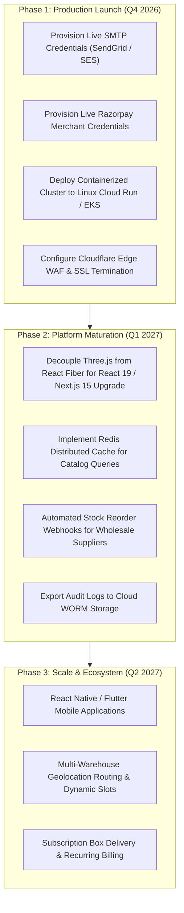

# Grocerly — Known Limitations, Technical Debt & Engineering Roadmap

**Document Identifier:** `DOC-DEBT`  
**Current Version:** 2.0.0  
**Status:** Verified & Active  
**Last Reviewed:** October 18, 2026  

---

## 1. Known Technical Debt & Architectural Limitations

### 1.1 Next.js 14 LTS vs Next.js 15+ Upgrade Blockers
- **Current State**: Grocerly is pinned to `next@14.2.35` (the latest upstream security-patched release in the Next.js 14 LTS line).
- **Limitation**: Several upstream Next.js security advisories (`GHSA-p293-qw3h-jr36`, `GHSA-2xp9-vwfh-vxw4`, `GHSA-m99w-x7hq-7vfj`) require Next.js $\ge$ 15.5.24 or Next.js 16. Upgrading to Next.js 15 requires React 19, which introduces breaking changes in `@react-three/fiber` (Three.js 3D produce dome) and Framer Motion.
- **Architectural Mitigations**:
  - Windows-specific RCE is mitigated because production deployments target Linux container environments.
  - Image optimization AVIF vulnerabilities are mitigated because Grocerly does not accept user-uploaded AVIF files.
  - Server Action advisories are mitigated because Grocerly exclusively uses Next.js Route Handlers (`app/api/**/route.ts`).
- **Remediation Plan**: Refactor 3D produce dome to decouple Three.js dependencies from React 19 before upgrading to Next.js 15 LTS.

### 1.2 Unconfigured External Third-Party Services
- **Transactional SMTP**:
  - `SMTP_HOST`, `SMTP_USER`, and `SMTP_PASS` are unconfigured in the default local environment.
  - Live customer emails (OTPs, password reset links, order receipts) cannot be dispatched to physical user inboxes without valid credentials.
  - Outside test fixtures, the system returns explicit configuration errors rather than fabricating fake success.
- **Razorpay Payment Gateway**:
  - `RAZORPAY_KEY_ID` and `RAZORPAY_KEY_SECRET` are unconfigured in local environments.
  - Online payment checkout safely fails with HTTP 503 `PAYMENT_PROVIDER_UNAVAILABLE`.
  - Cash on Delivery (COD) checkout remains 100% operational.

### 1.3 Audit Log Tamper Resistance
- **Current State**: The audit trail is stored in the MongoDB `auditlogs` collection with append-only application logic (no API mutation or deletion routes exist).
- **Limitation**: Records are stored in a standard MongoDB collection and are not cryptographically immutable or tamper-proof against a database administrator with direct write access.
- **Remediation Plan**: Stream audit events to write-once-read-many (WORM) cloud log sinks (AWS CloudWatch with Object Lock, Google Cloud Logging, or Datadog) for SOC 2 / PCI-DSS compliance.

---

## 2. Engineering Roadmap

### 2.1 Milestone Details

#### Milestone 1: Production Launch Readiness (Immediate)
- Populate live SMTP credentials in production secret manager.
- Populate live Razorpay credentials and register webhook endpoint.
- Verify production health probes on live domain (`https://grocerly.in/api/health`).

#### Milestone 2: Framework Upgrade & Performance (Next Sprint)
- Refactor `components/3d/FreshnessOrbit.tsx` to prepare for React 19 and Next.js 15.
- Introduce Redis/Upstash caching layer for `GET /api/products` to reduce database query load during peak traffic.
- Stream `auditlogs` to cloud log sinks for immutable regulatory retention.

#### Milestone 3: Ecosystem Expansion
- Develop dedicated mobile client applications utilizing the verified OpenAPI 3.1 specification (`docs/openapi.yaml`).
- Implement multi-warehouse routing based on GPS coordinates and real-time courier capacity.
